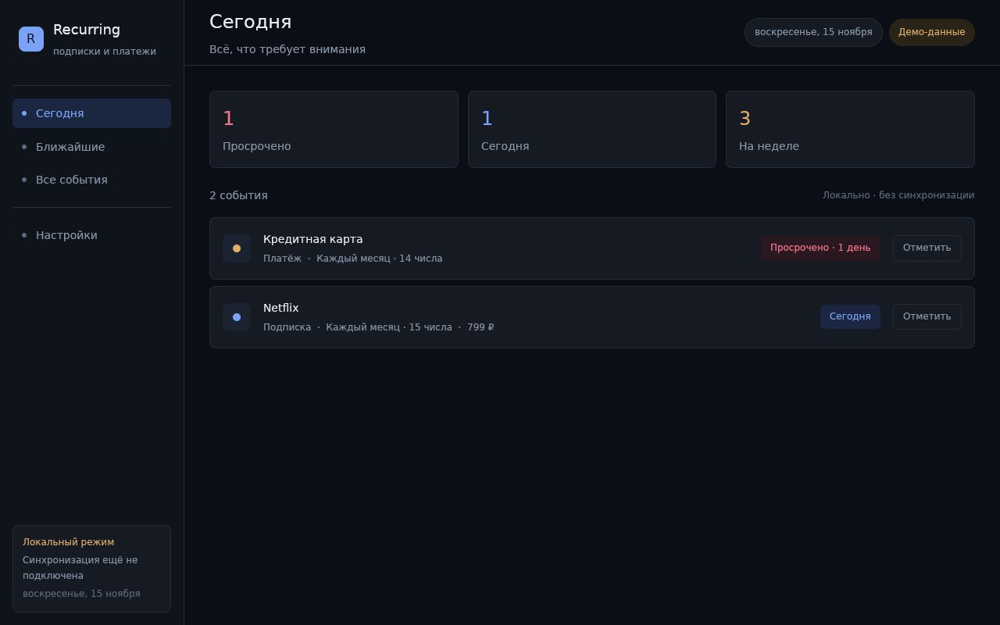

# Recurring

Нативное приложение для Linux и Windows: подписки, платежи по кредитке,
показания счётчиков и любые другие периодические события, которые нельзя
забывать.



Статус: **рабочий скелет**. Уже есть recurrence-движок с тестами, GPUI-окно с
демо-данными, CI на Linux/Windows и headless-скриншот в CI. Локальной базы,
синхронизации и уведомлений пока нет — это следующие шаги, см.
[`docs/decisions.md`](docs/decisions.md).

## Стек

- Rust 1.100.0, edition 2024
- [GPUI](https://crates.io/crates/gpui) 0.2.2 (Zed)
- `chrono` / `chrono-tz` для календарной арифметики и часовых поясов
- Supabase (free) для синхронизации между ПК и ноутбуком
- SQLite — будущий локальный source of truth

## Запуск

### Linux

```bash
./scripts/install-linux-deps.sh
cargo run -p recurring-app
```

Скриншотный режим (фиксированная дата и размер окна):

```bash
RECURRING_TODAY=2026-11-15 cargo run -p recurring-app -- --screenshot
```

### Windows

Нужны Rust 1.100.0 и MSVC build tools. GPU-рендеринг идёт через Direct3D.

```powershell
cargo run -p recurring-app
```

## Тесты и скриншоты

```bash
cargo test --workspace
cargo clippy --workspace --all-targets -- -D warnings
cargo fmt --all -- --check
```

Headless-скриншот использует настоящий бинарник, Xvfb, Openbox и программный
Vulkan (Mesa lavapipe):

```bash
./scripts/install-linux-deps.sh --screenshot
cargo build -p recurring-app
./scripts/screenshot-linux.sh
```

Результат: `artifacts/screenshots/today.png` плюс логи приложения, Xvfb и
Openbox. В CI этот же скрипт запускается на каждый push/PR и складывает PNG в
artifact.

## CI и релизы

- `.github/workflows/ci.yml` — fmt, clippy, тесты на Ubuntu и Windows,
  headless-скриншот.
- `.github/workflows/release.yml` — по тегу `v*` собирает переносимые архивы
  для Linux и Windows, считает SHA-256 и публикует GitHub Release.
- `.github/dependabot.yml` — обновления Cargo и GitHub Actions с cooldown
  **7 дней**.

Локальная проверка релизной сборки:

```bash
cargo build --release --locked -p recurring-app
```

## Supabase

Схема и RLS уже лежат в [`supabase/migrations`](supabase/migrations). Инструкция
по подключению проекта — в [`supabase/README.md`](supabase/README.md).

Коротко:

```bash
supabase link --project-ref <project-ref>
supabase db push
```

В приложении будет только `anon` key. `service_role` в клиент не попадает
никогда; доступ ограничен RLS по `auth.uid()`.

## Структура

```
crates/core/      домен, recurrence, деньги — без UI и сети
crates/app/       GPUI-клиент, тема, форматирование, демо-данные
supabase/         SQL-миграции и настройка облака
docs/             архитектура и список решений
scripts/          Linux-зависимости, headless-скриншот
```

Подробнее: [`docs/architecture.md`](docs/architecture.md).

## Политика обновлений

- Версия Rust зафиксирована в `rust-toolchain.toml` (`1.100.0`) — это явное
  требование проекта, хотя релиз 1.100.0 младше недели.
- Новые версии зависимостей и actions принимаются только через 7 дней после
  релиза (Dependabot `cooldown.default-days: 7`); будущие обновления Rust
  следуют тому же правилу.
- GPUI обновляется осознанно: это pre-1.0, автоматические minor-апдейты могут
  ломать API.

## Ближайшие шаги

1. SQLite + миграции, замена демо-данных.
2. Supabase Auth (email OTP), keychain, HLC и outbox-синхронизация.
3. Уведомления и tray-иконка (Linux `ksni`, Windows `Shell_NotifyIcon`).
4. Редактор события, история выполнений, экспорт JSON.
5. Пакеты AppImage/MSI, Android-клиент на общем `recurring-core`.

## Лицензия

MIT. См. [LICENSE](LICENSE).
